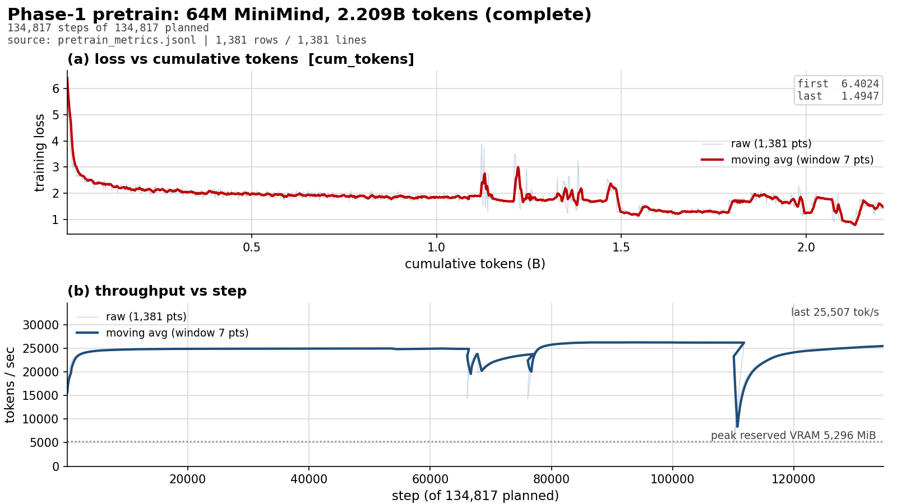
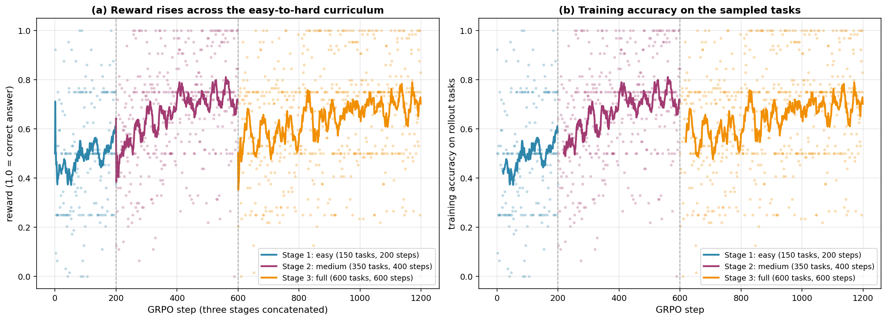

# MiniMind from scratch on one 8 GB laptop: Pretrain → SFT → GRPO

Training a **63.9 M-parameter** Transformer language model **from random initialization**
on a single RTX 4060 Laptop (8,188 MiB), then aligning it with
**GRPO using programmatically-verifiable rewards** (1.0 / 0.0, no LLM judge),
quantizing to **GGUF Q4_K_M** and running it locally with llama.cpp.

> Every number in this README is read from the run artifacts by
> [`tools/make_readme.py`](tools/make_readme.py); nothing is hand-typed or estimated.
> Regenerate with `python tools/make_readme.py`.


## 0. Quick start

This repo contains the **code, reports and figures**. Model weights, the corpora and the
tokenized blocks are **not** committed (they run from hundreds of MB to several GB); the
scripts below regenerate them.

```powershell
# 1) environment: venv + torch cu124 + MiniMind + its requirements
python setup.py

# 2) corpora from ModelScope (~9.4 GB, parallel range download at ~20-30 MB/s)
python download_data.py

# 3) tokenize the corpus into packed 512-token blocks (exact token count, no padding)
python custom/pretokenize_packed.py --src data/pretrain_t2t.jsonl `
    --out data/tokens --seq-len 512 --tag pretrain

# 4) pretrain from random init (~25 h on an RTX 4060 Laptop)
cd src/minimind-master/trainer
python ../../../custom/train_pretrain_packed.py `
    --data_path ../../../data/tokens/pretrain_blocks.bin `
    --batch_size 32 --max_seq_len 512 --use_compile 1 --seed 42 `
    --save_dir ../out --save_weight pretrain

# 5) SFT -> GRPO -> held-out eval -> GGUF, unattended
cd ../../..
python tools/run_pipeline.py --from 2 --to 5
```

Everything is seeded (`seed=42`), and every number in this README is regenerated from the
run artifacts by `tools/make_readme.py`.

### Verifying the results without retraining

The figures and `reports/grpo_vs_sft.json` are committed, so the headline claims can be
audited without a GPU:

```powershell
# per-task SFT vs GRPO outputs (24 tasks, with the grading reason for each)
python -c "import json;d=json.load(open('reports/grpo_vs_sft.json'));print(d['overall'])"

# the chance baseline the accuracy has to beat (14.2 %; 7/24 is the significance floor)
python tools/chance_baseline.py

# the training reward and the held-out grader must agree, or GRPO optimises the wrong
# objective -- this check is what caught 10 real disagreements during development
python tools/crosscheck_reward_vs_grader.py

# internal consistency of the published reports
python tools/check_artifact_contracts.py
```

### Repository layout

```
custom/     thin derivatives of the MiniMind trainers + data builders (training entry points)
tools/      evaluation, comparison, reporting, and the unattended pipeline
eval/       the frozen 24-task held-out benchmark + grader
demo/       CLI and web UI for the SFT-vs-GRPO comparison
reports/    the measured reports behind every number in this README
figures/    training curves
logs/       run summaries (small JSON; the raw per-step streams are not committed)
```

### What this project is *not*

It is not a fine-tune of a large model, and there is no RAG or agent orchestration here.
It is a from-scratch 63.9 M-parameter model trained end to end on one consumer GPU, with
the emphasis on **measurable, reproducible alignment** rather than absolute capability.
See section 8 for the honest limits of a model this size.

---
---

## 1. Results

| | Result |
|---|---|
| Pretraining tokens (measured) | **2,208,841,728** (2.209 B) |
| Model | 63,912,192 params (hidden 768, 8 layers, vocab 6,400) |
| Peak training VRAM | 5,296 MiB of 8,188 MiB (64.7 %) |
| Held-out accuracy, SFT baseline | **7/24** (29.2 %) |
| Held-out accuracy, after GRPO | **14/24** (58.3 %) |
| Delta | +7 task(s), McNemar exact p = 0.0390625 |
| GGUF Q4_K_M accuracy drop (SFT) | 7 → 5 of 24 tasks |
| GGUF Q4_K_M accuracy drop (GRPO) | 14 → 12 of 24 tasks |

## 2. Token accounting (the three required figures)

| Phase | What is counted | Tokens | Basis |
|---|---|---|---|
| 1. Pretrain | training tokens fed to the model | **2,208,841,728** | `sum(input_ids.numel())` per step, packed 512-token blocks, no padding |
| 2. SFT | training-set tokens (padded) / supervised | **153,600,000** / 66,203,231 | `input_ids.numel()` / `(labels != -100).sum()` |
| 3. GRPO | sampled completion tokens | **1,639,872** | `completion_mask.sum()` summed over every step |
| **Total** | 1 + 2 + 3 | **2,364,081,600** | |

Prompt tokens during GRPO rollout are tracked separately and are **not** added to
the total (they are conditioning context, not newly sampled tokens).

## 3. Phase 1 — Pretraining from random initialization

| Metric | Value |
|---|---|
| Corpus | MiniMind `pretrain_t2t.jsonl`, 8,468,827 documents |
| Corpus tokens (tokenizer output) | 2,208,852,597 |
| Steps | 134,817 of 134,817 planned |
| Sequence length / batch | 512 tokens × 32 = 16,384 tokens/step |
| Optimizer | AdamW, lr 5e-4, cosine annealed to 0.1× |
| Precision | bf16 autocast + `torch.compile` (triton-windows) |
| Throughput | 25,507 tokens/s (last logged) |
| Loss | 6.4024 → 1.4947 (min 0.7286) |
| Wall time (all 4 segments) | 24.88 h |



## 4. Phase 2 — SFT

| Metric | Value |
|---|---|
| Records | 200,000 |
| General chat share | 80 % (160,000 records) |
| Task-shaped "format seeding" share | 20 % (40,000 records) |
| Held-out leakage | 0 |
| Supervised tokens | 66,203,231 |

The 20 % task-shaped component is deliberately **narrow and easy** (single-digit
addition, YES/NO, JSON, parity) so SFT learns the *output format* without the
reasoning range the held-out set tests — the "knows the format, cannot reason"
regime that GRPO is supposed to close.

SFT held-out baseline (greedy, `prompt_mode=chat`, 24 tasks):

| family | correct | accuracy |
|---|---|---|
| arithmetic | 1/8 | 12.5 % |
| format | 3/6 | 50.0 % |
| logic | 2/6 | 33.3 % |
| multistep | 1/4 | 25.0 % |
| **overall** | **7/24** | **29.2 %** |

## 5. Phase 3 — GRPO with programmatically-verifiable rewards

Reward is a pure function of the task spec: **1.0 if the answer parses and is correct,**
**else 0.0**. No learned reward model, no LLM judge. Four checkers:
`exact_int`, `exact_json`, `choice`, `label`.

MiniMind's stock GRPO uses an `internlm2-1.8B` neural reward model — i.e. exactly
the LLM judge this project forbids — so `custom/train_grpo_rule.py` is a thin
derivative that keeps the GRPO math (group-normalised advantages, PPO clip, k3 KL
estimator, `TorchRolloutEngine`) and replaces only the reward function.

| stage | steps | sampled tokens |
|---|---|---|
| grpo_stage1_easy | 200 | 313,216 |
| grpo_stage2_medium | 400 | 487,424 |
| grpo_stage3_full | 600 | 839,232 |
| **total** | **1,200** | **1,639,872** |



*Reward and training accuracy across the three-stage easy-to-hard curriculum. Each
dashed line marks a stage boundary; the reward plateaus per stage because the task
difficulty steps up.*

### SFT vs GRPO on the held-out set

| family | SFT | GRPO | delta |
|---|---|---|---|
| arithmetic | 1/8 | 7/8 | +6 |
| format | 3/6 | 2/6 | -1 |
| logic | 2/6 | 2/6 | +0 |
| multistep | 1/4 | 3/4 | +2 |
| **overall** | **7/24** | **14/24** | **+7** |

McNemar exact test: b={'name': 'sft_only_right', 'count': 1} (SFT-only right), c={'name': 'grpo_only_right', 'count': 8} (GRPO-only right), **p = 0.0390625**, significant at 5 %: True.

**Verdict:** GRPO improves overall accuracy by 7/24 (7/24 -> 14/24, 29.2% -> 58.3%); exact McNemar p = 0.0391, i.e. the delta is statistically distinguishable at the 5 % level.
Families that improved: arithmetic (1/8 -> 7/8), multistep (1/4 -> 3/4).
Families unchanged: logic.
Families that regressed: format (3/6 -> 2/6).
No reason rule fired: the observed pattern does not match any of the pre-registered explanations, so no cause is claimed.

Chance baseline: a guessing model scores 14.2 % on this benchmark (3.4 of 24 tasks), because `format` and `logic` are 2-3-way choices. 7/24 correct is the minimum that beats chance at the 5 % level.
Token accounting is in `token_accounting`; grand total 2,364,081,600 tokens.

A 24-task benchmark means one task = 4.2 pp, so the McNemar test is reported
specifically to keep a 1–2 task delta from being over-read as an improvement.

**Chance baseline:** a guessing model scores **14.2 %** (3.4 of 24 tasks) because the
`format` and `logic` families are 2–3-way choices. **7/24 correct** is the
minimum that beats chance at the 5 % level; anything below that is noise.

| family | tasks | chance accuracy |
|---|---|---|
| arithmetic | 8 | 3.2 % |
| format | 6 | 23.9 % |
| logic | 6 | 26.6 % |
| multistep | 4 | 3.2 % |

## 6. Phase 4 — GGUF Q4 quantization and local deployment

| artifact | size |
|---|---|
| `full_sft_768-Q4_K_M.gguf` | 42.5 MB |
| `full_sft_768-f16.gguf` | 128.1 MB |
| `grpo_smoke_768-Q4_K_M.gguf` | 42.5 MB |
| `grpo_smoke_768-f16.gguf` | 128.1 MB |
| `grpo_stage3_full_768-Q4_K_M.gguf` | 42.5 MB |
| `grpo_stage3_full_768-f16.gguf` | 128.1 MB |
| `sft_smoke_768-Q4_K_M.gguf` | 42.5 MB |
| `sft_smoke_768-Q8_0.gguf` | 68.2 MB |
| `sft_smoke_768-f16.gguf` | 128.1 MB |

Two traps found the hard way (both would silently break deployment):

1. The llama.cpp **CUDA zip ships without its CUDA runtime DLLs** — `llama-cli`
   then reports no devices and silently falls back to CPU. The separate
   `cudart-*.zip` must be merged in.
2. GitHub `releases/latest` points at a **decoy** tag whose only asset is
   `nightly-tag.txt`; real binaries live under `bNNNN` tags.

### Demo

```powershell
# side-by-side CLI: same prompt, SFT vs GRPO
python demo/compare_cli.py --prompt "3+5等于几？只回复数字" `
    --sft  models/gguf/full_sft_768-Q4_K_M.gguf `
    --grpo models/gguf/grpo_stage3_full_768-Q4_K_M.gguf --max-new-tokens 48

# web UI (Gradio :7860, or the stdlib fallback :7861)
python demo/app.py --ui gradio --port 7860
```

Every llama.cpp call uses `-ngl 0` (CPU) so the demo never competes with training
for VRAM. Measured on this machine: **518 tok/s** for Q4_K_M on CPU,
**939 tok/s** at `-ngl 99` on GPU.

## 7. Reproduce

```powershell
# 0) environment
uv venv .venv --python 3.11
$env:UV_CACHE_DIR="$PWD\.cache\uv"
uv pip install --python .venv\Scripts\python.exe torch==2.6.0 torchvision==0.21.0 --index-url https://download.pytorch.org/whl/cu124
uv pip install --python .venv\Scripts\python.exe -r src\minimind-master\requirements.txt --index-url https://mirrors.aliyun.com/pypi/simple/
uv pip install --python .venv\Scripts\python.exe numpy==2.2.6 triton-windows==3.2.0.post21

# 1) data -> packed token blocks (exact token count, no padding)
python custom/pretokenize_packed.py --src data\pretrain_t2t.jsonl `
    --out data\tokens --seq-len 512 --tag pretrain

# 2) pretrain from random init (2.209 B tokens, ~29 h on a 4060 Laptop)
cd src\minimind-master\trainer
python ..\..\..\custom\train_pretrain_packed.py `
    --data_path D:\llm-rl-lab\data\tokens\pretrain_blocks.bin `
    --batch_size 32 --max_seq_len 512 --use_compile 1 --seed 42 `
    --save_dir D:/llm-rl-lab/src/minimind-master/out --save_weight pretrain

# 3) SFT (200k records: 80 % chat + 20 % format seeding)
python ..\..\..\custom\train_full_sft_counted.py `
    --data_path D:\llm-rl-lab\data\sft\sft_train.jsonl `
    --from_weight pretrain --save_weight full_sft --batch_size 16 --max_seq_len 768

# 4) GRPO, staged easy -> medium -> full
python tools\run_phase3.py --execute --from-weight full_sft --device cuda

# 5) held-out comparison + GGUF export
python tools\compare_sft_grpo.py --sft ...\full_sft_768.pth --grpo ...\grpo_stage3_full_768.pth `
    --out reports\grpo_vs_sft.json --device cuda
python tools\run_pipeline.py --phase 4
```

Determinism: `seed=42` is fixed in every trainer, the data builders, and the
evaluator. `torch.backends.cudnn.deterministic` is set in the eval harness.

## 8. Honest limitations

- **Model size.** 63.9 M parameters is ~1/2000th of a 7 B model. Arithmetic beyond
  single digits and multi-step reasoning are at or beyond its capacity ceiling.
- **Benchmark granularity.** 24 tasks → one task = 4.2 pp. Deltas of 1–2 tasks are
  reported with an exact McNemar p-value precisely so they are not over-claimed.
- **Single-token answers.** The tokenizer makes every integer 0–25 a single token,
  so the arithmetic tasks measure prompt→answer-token retrieval, not digit
  composition. This is stated rather than hidden.
- **GRPO sparsity.** All-wrong groups produce `adv_std = 0` and therefore zero
  gradient; this was measured and drove the easy→hard curriculum design.

## 9. Environment

| Item | Value |
|---|---|
| GPU | NVIDIA RTX 4060 Laptop, 8,188 MiB, sm_89 |
| CPU / RAM | i7-13700H / 16 GB DDR5 |
| OS | Windows 11, native (no WSL, no Docker) |
| Python | 3.11.9 + uv |
| torch | 2.6.0+cu124, bf16, `torch.compile` via triton-windows 3.2.0.post21 |
| Framework | MiniMind (PyTorch native, Pretrain/SFT/GRPO) |

---

*README generated 2026-10-22 17:30:23 from measured artifacts by
`tools/make_readme.py`.*

## License

MIT — see [LICENSE](LICENSE). Third-party attributions (MiniMind is Apache-2.0) are in
[THIRD_PARTY_NOTICES.md](THIRD_PARTY_NOTICES.md).

Built on [MiniMind](https://github.com/jingyaogong/minimind), which setup.py clones at
install time rather than vendoring here. The model weights, corpora and tokenized blocks
are **not** included; see section 0 to regenerate them.